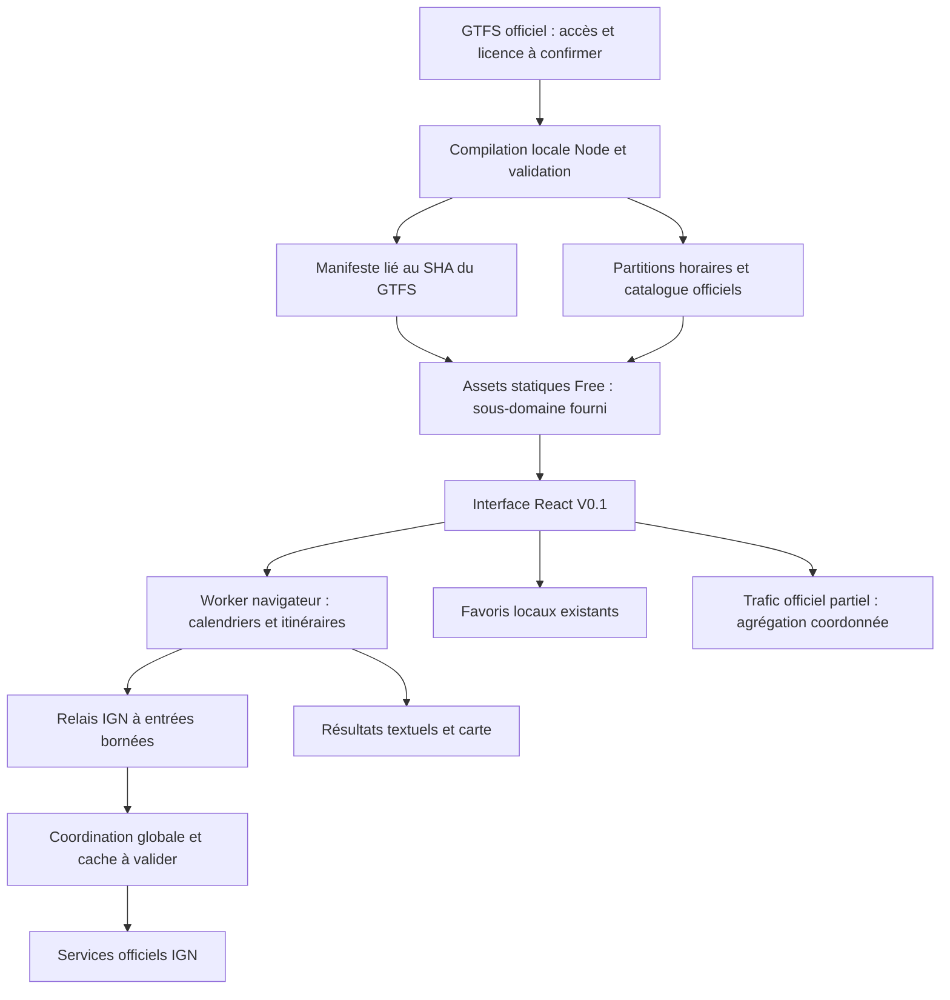

# Architecture cible à coût obligatoire nul — V0.1

Décision d'étude du **9 novembre 2026**, fondée sur [l'audit mesuré](AUDIT-GRATUITE.md). **Aucune architecture de production n'est changée ni déclarée validée.** Le périmètre local complet reste en place et la version V0.1 ne change pas.

## 1. Comparaison des options

| Option | Faisabilité et mesures | Performance / limites | Maintenance et migration | Verdict |
| --- | --- | --- | --- | --- |
| **A — D1 relationnel optimisé + calcul Worker** | La taille peut être réduite : copie numérique réversible de 167,65 MB contre 416,70 MB aujourd'hui. Le stockage seul n'est donc pas l'obstacle principal. | Le moteur froid actuel demeure trop lourd pour une invocation Workers ordinaire ; la réduction de base ne réduit pas à elle seule son heap ou ses profils. Les millions de lignes à renouveler restent un problème d'écritures. Les lectures scannées D1 sont inconnues. | Réécriture des jointures pour IDs numériques, tests de parité, index et comptage D1, import initial et renouvellement à résoudre. Complexité forte ; risque de base périmée pendant un import étalé. | **COMPATIBLE SOUS CONDITIONS** pour un futur modèle ; **INCOMPATIBLE AVEC L'OFFRE GRATUITE** en portage direct du moteur actuel |
| **B — GTFS précompilé statique + moteur navigateur** | Sonde du 09/11 : 464 182 horaires, 13 MB bruts / 2,77 MB gzip ; dictionnaires globaux 1,07 MB gzip. Possibilité réelle de réduire les données reçues par journée/service. | Évite le calcul serveur par utilisateur ; CPU/mémoire déplacés vers le terminal, pas supprimés. La sonde n'inclut pas un routage fonctionnel ni les jours adjacents. Le confort sur vrai téléphone est **NON VÉRIFIÉ**. | Compilation versionnée, index et décodage, worker navigateur, tests de calendriers, livraison partielle. Complexité forte mais pipeline gratuit local. Risques : gros premier téléchargement, cache navigateur ancien, droits de redistribution. | **COMPATIBLE SOUS CONDITIONS** ; piste mesurée, pas fonctionnalité livrée |
| **C — Hybride : données statiques + calcul client + services serveur limités** | Reprend B pour GTFS ; conserve des relais contrôlés pour IGN et un agrégateur Trafic. Favoris et carte réutilisables. Aucun besoin obligatoire de stocker des millions de lignes D1. | Les fonctions ordinaires ne font que les tâches courtes ; quota réseau/collecte coordonné. Les adresses restent utilisables seulement si la marche peut être obtenue sans dépasser les limites. Pas d'appel IGN direct par chaque navigateur. | Adaptation des services frontend vers un worker navigateur, contrat de données, garde globale fournisseur, caches vérifiés et repli. Complexité forte, mais traite les trois obstacles mesurés : CPU serveur, import relationnel et mémoire d'objets. | **COMPATIBLE SOUS CONDITIONS** ; **recommandation pour le prochain prototype local** |
| **D — Durable Objects Free pour calcul/coordination** | La [documentation actuelle](https://developers.cloudflare.com/durable-objects/platform/limits/) distingue les DO des Workers ordinaires : budget CPU standard de 30 s, stockage SQLite possible. Ce n'est pas une offre automatiquement payante. | [Free DO](https://developers.cloudflare.com/durable-objects/platform/pricing/) : 100 000 requêtes/jour, 13 000 GB-s/jour, 5 GB SQLite, quotas de lignes. Un transfert direct du moteur conserve son problème mémoire ; la durée inclut l'attente IGN et peut consommer l'enveloppe. | Un coordinateur étroit de quotas/cache est plus plausible qu'un déplacement aveugle du moteur complet. Un stockage compact par blocs est une autre étude, non mesurée sur DO. Pas de namespace, binding ou compte provisionné. | **COMPATIBLE SOUS CONDITIONS** pour coordination ; moteur DO complet **NON VÉRIFIÉ** |

Un PC personnel peut continuer à faire fonctionner la version locale sans abonnement d'hébergement. Ce n'est pas une solution publique à disponibilité garantie ni une promesse d'électricité/connexion gratuites. Aucune offre à carte bancaire, VPS payant ou franchise facturable R2 n'est retenue comme solution de secours.

La recommandation C vient des tailles réellement mesurées et de l'écart de CPU/mémoire observé, **pas d'un benchmark de la future architecture**. Aucun choix irréversible n'a été appliqué. Si la parité et les budgets mobiles échouent, revenir à la comparaison A/D au lieu d'abaisser les contrôles métier.

## 2. Cible à prototyper

Le schéma décrit un **projet de migration**, pas l'état actuellement exécuté. Le calcul client utilise une version du même modèle métier, pas un moteur simplifié caché : mêmes séquences, sens, calendriers, exceptions, règles de transfert, marges et limites explicites. Le SQL du moteur actuel n'est pas directement exécutable dans un Web Worker ; un accès aux données indexées est à concevoir et à comparer, sans changer arbitrairement les parcours retenus.

### Données statiques

- Manifeste immuable par SHA, schéma de format distinct du numéro public V0.1, origine et validité, checksums et tailles de chaque partition.
- Catalogue minimal pour autocomplétion et quais homonymes, IDs GTFS exacts, relations ligne/quai et transferts orientés. Les coordonnées ne créent pas de correspondance.
- Horaires organisés par services/route avec index de sélection temporelle ; il existe 3 356 groupes route/service dans l'archive. Leur volume final et le nombre de requêtes ne sont pas encore mesurés.
- Charger les services nécessaires et les jours de service adjacents pour le dépassement de minuit et les changements d'heure. Une partition du seul jour civil serait incorrecte.
- Budgets initiaux à éprouver : téléchargement GTFS initial inférieur à 5 MiB compressés sur les trajets de référence, partitions inférieures à 4 MiB, cache borné en octets, pas de chargement des 2,9 millions d'horaires dans le navigateur. Ce sont des **critères du prototype**, pas des résultats acquis.
- Ne pas utiliser de Range implicite pour un énorme fichier : le service [Static Assets peut répondre le fichier complet](https://developers.cloudflare.com/workers/static-assets/billing-and-limitations/#range-requests). Préférer des partitions réellement séparées.
- La sonde binaire 28 octets est un outil de mesure ; pas un format de production à figer avant un décodeur testé et une validation aller/retour complète.

### IGN, trafic et maîtrise des quotas

Le relais IGN doit conserver hôtes et paramètres autorisés, profils, contrôles de durée/distance, CRS, raccordements et origine des données. Le navigateur n'appelle pas IGN directement. Un cache de marche doit rester directionnel et lié aux paramètres/réseau ; un échec n'est pas une réponse positive à conserver.

Une file par isolate ne suffit pas : prévoir un coordinateur unique logique, éventuellement un DO SQLite **Free** après validation locale et du compte. Il distribue des autorisations bornées, tient un quota journalier technique, partage les attentes et respecte Retry-After. En cas d'absence du coordinateur, refuser les nouvelles marches plutôt que relancer des appels sans contrôle. La capacité journalière de l'application reste à mesurer ; ne pas publier un nombre d'utilisateurs garanti.

Le trafic ne doit pas être reparsé par chaque navigateur ou chaque isolate. L'agrégateur doit vérifier la politique, limiter la collecte, conserver la date réelle et servir une photographie partielle avec états par ligne. Le coût CPU de parse5 doit aussi être mesuré ; l'extrait public T3 autorisé prend 36,37 ms murales lors de sa première analyse locale, puis 2,19–3,91 ms sur cinq répétitions. Ce n'est ni un profil Worker ni le coût d'une collecte de pages complètes.

Les Ordinary Workers Free ne doivent pas cacher le calcul GTFS lourd dans un `waitUntil`, un Cron ou une chaîne de requêtes pour tenter de contourner une limite. Le DO est un produit distinct à enveloppe documentée, pas une extension illimitée du Worker d'entrée.

## 3. Réutilisation et changements nécessaires

À préserver : interface V0.1, formulaires et sélection explicite, favoris et migration, types de résultats, affichage théorique, phases réelles, annulation, protection contre les réponses obsolètes, texte complet lorsque la carte échoue. Les cartes ne doivent pas recalculer une marche IGN et ne doivent toujours pas inventer un tracé TCL.

À adapter seulement après diagnostic/prototype : couche d'accès aux horaires, planificateur isolé en worker navigateur, export de données et manifeste, API cartographique ou lecture locale des arrêts sélectionnés, agrégation Trafic sans base relationnelle complète, coordination IGN globale. Les attributions, confidentialité et preuves de validité font partie de la livraison, pas d'une tâche facultative après publication.

Le moteur reste limité à deux correspondances et à son périmètre actuel tant qu'une extension n'est pas validée. Une réduction du périmètre de production, par exemple une version uniquement entre arrêts, devrait être **un choix explicite de l'utilisateur** : elle n'a pas été appliquée pendant l'audit pour obtenir artificiellement une compatibilité gratuite.

## 4. Coûts et engagement du zéro euro

La cible n'ajoute aucun achat de domaine : sous-domaine offert par l'hébergeur. Aucun abonnement ni produit à dépassement facturable n'est requis ; les comptes et bindings doivent rester Free et refuser l'usage une fois leur enveloppe épuisée. Le détail des montants et limites officielles se trouve dans [AUDIT-GRATUITE.md](AUDIT-GRATUITE.md), pour éviter trois tableaux de quotas divergents.

Le pipeline local, les assets, le worker navigateur, les favoris et MapLibre peuvent ne générer aucune facture de service. IGN, TCL, droits GTFS et coordinateur demeurent conditionnels. Les coûts de temps humain, matériel existant et connexion ne sont pas présentés comme annulés. Aucun budget infini, disponibilité contractuelle ou accès fournisseur permanent n'est garanti.

## 5. Risques et critères bloquants

| Sujet | Porte de validation avant choix définitif |
| --- | --- |
| GTFS | Source officielle accessible légalement sans offre payante ; licence exacte, redistribution et renouvellement confirmés |
| Parité | Même validité/calendriers/DST, départ/arrivée, correspondances orientées et horaires ; résultats audités contre SQLite active |
| Mobile | Vrai appareil en plus d'Edge émulation, mémoire et premier chargement mesurés, défilement/carte/favoris conservés |
| Ressources serveur | Tous les chemins ordinaires froids sous budget avec marge ; aucun travail lourd déplacé discrètement dans une autre requête |
| Globalité des quotas | Tests de clients concurrents et redémarrage d'isolate ; coordinateur/cache indisponible = refus contrôlé |
| Publication | HTTPS, en-têtes, routage des assets, mentions et consentement explicite au déploiement ; zéro carte bancaire et zéro produit payant |

**Statut de la cible : COMPATIBLE SOUS CONDITIONS, prototype non réalisé. Verdict du projet actuel pour sa migration directe : ARCHITECTURE À REVOIR.**
