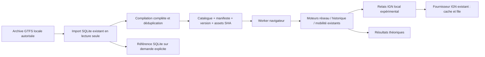

# Préparation de migration hybride — MonTrajet Lyon V0.1

Décision du **10 novembre 2026** : **ENCORE PARTIELLEMENT VALIDÉ**.

La compilation couvre désormais toute la période GTFS locale et les sept catégories de parcours s'exécutent dans le Worker. Les comparaisons réalisées ne présentent pas de divergence inexpliquée. Le périmètre s'est élargi, mais ces preuves locales ne justifient pas encore de remplacer le moteur des utilisateurs.

## Sélection de moteur sans bascule active

`experiments/hybrid/engine-selector.ts` définit un sélecteur injectable :

- **SQLite par défaut**.
- Hybride refusé tant que `experimentalEnabled` n'est pas explicitement activé par le laboratoire.
- Un seul moteur est exécuté par une recherche normale.
- Le mode **Comparer explicitement les deux** appartient au laboratoire ; il appelle les deux moteurs intentionnellement et compare les structures complètes, métriques exclues.

Ce module n'est importé ni par `src` ni par la configuration de l'application active. Aucun drapeau global, localStorage utilisateur ou changement du moteur de production n'est ajouté. Le laboratoire ne transforme pas une erreur hybride en succès SQLite sans l'annoncer.

Le client Worker implémente l'identité des recherches, la terminaison sur annulation, le rejet de la recherche précédente et le filtrage des réponses anciennes. La progression vient des services existants. Les favoris QA sont construits à l'aide du modèle courant, sans écrire dans le magasin des favoris de l'utilisateur.

## Architecture préparée



La source des données de chaque fichier est liée par SHA au manifeste et à l'archive. La publication future devra utiliser des snapshots immuables, un pointeur revalidable, une validation avant bascule et un rollback. Le mécanisme d'exercice local `version-store.mjs` et ses tests restent disponibles, sans être branchés sur l'application active. Aucune bascule d'hébergement ni publication atomique distante n'a été testée.

## Preuves acquises

| Domaine | État |
|---|---|
| Période GTFS | 121 dates compilées et contrôlées, 92 profils, 185 assets uniques |
| Couverture fonctionnelle demandée | Sept catégories exécutées dans le Worker, incluant adresses et favoris |
| Parité entre arrêts | 47 recherches structurées, zéro divergence |
| Parité navigateur porte-à-porte | 21 comparaisons Edge et 21 Firefox, plus deux cas Arriver avant |
| Moteur historique | Option à une correspondance couverte par l'adaptateur et les comparaisons |
| Cache/version/date | LRU borné, partage exact, pointeur léger, changement rapide et erreurs testés |
| Non-régression | 257 tests réussis, lint, TypeScript et builds réussis |
| Données actives | Empreintes de la base et du ZIP inchangées, V0.1 conservée |

Les 121 dates ne signifient pas toutes les lignes desservies chaque jour. Les résultats sans trajet et les états d'exploration limitée sont préservés. La matrice n'est pas une démonstration d'optimalité globale ou d'équivalence pour tous les couples d'arrêts.

## Conditions encore nécessaires

1. **Mobile physique.** Le poste dispose d'environ 32 Go de RAM. Les vues étroites et le CPU ralenti du thread principal ne prouvent pas la tenue d'un téléphone à faible mémoire ; le ralentissement CPU du Worker est indisponible. Les maxima de tas/backing storage sont échantillonnés, pas une RSS ni un pic exhaustif.
2. **Porte-à-porte en conditions vivantes.** Les 54 compléments officiels IGN et le protocole HTTP ont été vérifiés, mais les répétitions navigateur utilisent un rejeu explicite. Il reste à tester une session utilisateur complète avec le fournisseur vivant, des erreurs intermittentes, les quotas et le comportement prolongé.
3. **Relais gratuit partagé.** Le calcul GTFS peut être statique ; IGN et Trafic nécessitent encore une stratégie serveur. Une recherche avec marche peut demander jusqu'à 48 calculs/caches de marche au relais, plus la résolution des adresses. Réutiliser le cache fournisseur évite des appels amont, pas toutes les requêtes HTTP au relais. Les quotas d'un hébergement gratuit distribué restent à mesurer ; le cache/file d'un processus local ne prouve pas une coordination mondiale.
4. **Première visite sur réseau lent.** Environ 10,22 s dans la simulation locale. Pas de cache persistant applicatif entre rechargements. Tout partitionnement supplémentaire doit conserver les courses et correspondances utiles.
5. **Renouvellement et droits.** L'archive locale n'a pas été renouvelée. La demande d'accès technique Grand Lyon et les conditions de redistribution restent celles du rapport source. Un build compatible en taille n'est pas une autorisation de publication.
6. **Intégration React réelle.** Le sélecteur est isolé, pas relié aux écrans actifs. Une migration devra faire passer les requêtes exactes de ces écrans, traiter l'état du Worker, préserver les favoris existants, le trafic et la carte, puis retester le parcours complet sur appareils cibles. Le laboratoire ne revendique pas la migration des API Horaires/recherche/cartographie.
7. **Publication distante.** Hébergement, cache, bascule de version et rollback doivent être prouvés dans un environnement gratuit autorisé avant ouverture, sans rendre le backend actuel dépendant du prototype.

L'adaptateur historique applique actuellement le tri et la limite SQL de 20 001 lignes après avoir construit les correspondances candidates de son lot. La parité est testée, mais le pic de cet accumulateur n'est pas qualifié sur les lots les plus larges du réseau. Il faudra le borner pendant l'énumération en conservant exactement l'ordre SQL, puis refaire les oracles, avant de garantir un budget mémoire universel pour ce chemin.

## Migration progressive recommandée

Conserver SQLite comme référence et moteur actif. Après validation sur mobile physique et obtention des droits/renouvellement, brancher le sélecteur sur un mode développeur explicitement autorisé. Comparer un jeu déterministe hors production ; ne pas doubler chaque requête publique. Commencer ensuite par les trajets entre arrêts pour des testeurs volontaires, avec source de résultat visible et retour contrôlé. Les adresses/favoris suivraient après qualification du relais et de ses quotas. Une nouvelle décision explicite serait nécessaire pour activer ce périmètre ; rien de cela n'est activé par cette mission.

## Fichiers créés ou modifiés

Créés :

- `scripts/prototype/compile-full.mjs`, `validate-full.mjs` : toute la validité, assets dédupliqués et oracle SQLite.
- `experiments/hybrid/geographic-rpc.ts`, `client.ts`, `engine-selector.ts` : relais du fournisseur, cycle Worker et sélection isolée.
- `experiments/hybrid/scenarios.ts`, `mobility.html`, `mobility-browser.ts` : parcours et favoris QA, interface explicite.
- `scripts/prototype/geographic-provider.mjs`, `mobility-api.mjs`, `record-complete.mjs` : réutilisation IGN, rejeu explicite et complément borné.
- `scripts/qa/firefox-driver.mjs`, `scripts/prototype/complete-browser.mjs`, `date-switch.mjs` : matrice navigateur et dates rapides.
- `tests/hybrid-complete.test.mjs`, `scripts/prototype/summarize-complete.mjs`, les trois rapports et leurs preuves JSON.

Modifiés : `experiments/hybrid/database.ts`, `load.ts`, `runtime.ts`, `browser-worker.ts`, `scripts/prototype/serve.mjs`, `static-build.mjs`, `browser-memory.mjs`, `README.md`. Aucun module métier actif sous `src` ou `server` n'a été modifié.

## Commandes de reproduction

Depuis `montrajet-lyon`, laboratoire déterministe avec rejeu clairement indiqué :

```powershell
node scripts/prototype/serve.mjs .data/hybrid-full-1794333824540 .data/hybrid-complete-ign-1794334290229/official-replay.json
# Le serveur affiche les deux URL locales, sur un port libre.
node scripts/prototype/complete-browser.mjs .data/hybrid-full-1794333824540 edge
node scripts/prototype/complete-browser.mjs .data/hybrid-full-1794333824540 firefox
node scripts/prototype/date-switch.mjs .data/hybrid-full-1794333824540
node scripts/prototype/browser-memory.mjs .data/hybrid-full-1794333824540
node scripts/prototype/static-test.mjs .data/hybrid-dist-1794334796287
node scripts/prototype/summarize-complete.mjs
npm.cmd test
npm.cmd run lint
node node_modules/typescript/bin/tsc -p tsconfig.hybrid.json
npm.cmd run build
```

Sans l'argument de rejeu de `serve.mjs`, les adresses/marches passent au fournisseur en ligne existant ; ne pas répéter inutilement les calculs source. `record-complete.mjs` constitue un collecteur QA borné, pas une tâche périodique à lancer en boucle. Chaque génération et campagne de tests crée un nouveau dossier ; les chemins ci-dessus désignent les observations réellement utilisées pour ce rapport.

Les empreintes finales sont conservées dans [la synthèse vérifiable](evidence/hybrid-complete-2026-11-10.json). Voir aussi [la couverture temporelle](COUVERTURE-GTFS-HYBRIDE.md) et [la parité/performance détaillées](PARITE-HYBRIDE-COMPLETE.md).
