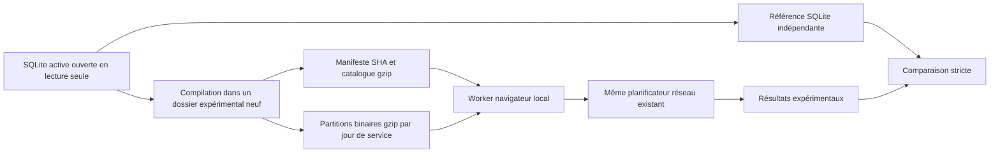

# Prototype local d'architecture hybride — V0.1

Expérimentation du **9 novembre 2026**. Verdict : **PROTOTYPE HYBRIDE PARTIEL**.

Le cœur GTFS précompilé a été exécuté et comparé, y compris dans Edge. L'application active n'est pas migrée. Le renouvellement authentifié, les services distribués et l'exploitation Cloudflare Free ne sont pas validés. Voir [SOURCE-GTFS-DURABLE.md](SOURCE-GTFS-DURABLE.md).

## 1. Architecture expérimentale réellement implémentée

Tout le nouveau code est dans `experiments/hybrid/`, `scripts/prototype/` et les nouveaux outils de source GTFS. **Aucun import depuis l'application React active** et aucune adaptation de son moteur ne les active.



Le compilateur utilise une connexion SQLite **readOnly** et écrit uniquement des copies/transformations dans un nouveau dossier `.data/hybrid-static-…`. Il ne recopie pas la base active par-dessus un fichier existant.

Le catalogue conserve les IDs officiels, quais, coordonnées, lignes, directions/headsigns, transferts orientés et associations ligne–arrêt. Les horaires sont encodés sur **28 octets** : indices de course/quai, séquence, arrivée/départ avec sentinelle null, headsign et drapeaux pickup/dropoff/timepoint. L'encodage est little-endian ; une architecture différente est refusée explicitement.

Le calendrier est résolu lors de la compilation de chaque **jour de service**, avec exceptions. Le moteur conserve le calcul temporel GTFS existant, y compris après 24 h et les jours adjacents. Le chargeur n'invente pas une partition manquante : il échoue explicitement. Les fichiers gzip sont contrôlés par SHA et tailles avant utilisation ; la taille décompressée est bornée. L'empreinte du catalogue doit correspondre au manifeste.

`StaticDatabase` remplace uniquement les opérations de lecture actuellement nécessaires au planificateur réseau et au planificateur mobilité. Ce n'est pas un interpréteur SQL général. Les requêtes inconnues sont refusées, sans repli caché sur SQLite. Les index CSR par quai et les plages par course utilisent des tableaux typés ; le cache est borné à trois jours.

La version du **format expérimental** est 1 ; ce n'est pas une modification de la version publique V0.1. Les identifiants synthétiques des tests sont isolés en mémoire et ne sont jamais compilés dans les fichiers GTFS du laboratoire servi dans Edge.

## 2. Données et volumes réellement produits

Source : archive locale déjà importée, SHA `7b9f4d1b94e054d6d47159130d34c972a083c750ce5a106f0786e386f878225d`. Validité : 08/11/2026–08/03/2027. Pas de téléchargement nouveau du GTFS.

Package créé : `.data/hybrid-static-1794254012321/`. Compilation mesurée : **13 248,6 ms**.

| Fichier expérimental | Octets compressés | Octets décompressés | Horaires |
| --- | ---: | ---: | ---: |
| Catalogue global | 1 090 076 | 14 854 229 | Dictionnaires, pas les horaires complets |
| Jour de service 08/11/2026 | 1 119 938 | 5 129 096 | 183 182 |
| Jour de service 09/11/2026 | 2 832 994 | 12 997 096 | 464 182 |
| Jour de service 10/11/2026 | 2 843 745 | 13 053 460 | 466 195 |

Ces trois jours sont le périmètre compilé, **pas toute la période GTFS**. Le navigateur charge le catalogue puis seulement les jours requis : **3 923 070 octets** pour une recherche du 9 novembre en journée ; **6 766 815 octets cumulés** lorsque la nuit nécessite aussi le 10 novembre. Ces compteurs concernent les fichiers de données compressés, hors manifeste, code JavaScript, HTML et en-têtes HTTP. Ils ne doivent pas être assimilés à la taille décompressée en mémoire.

Le package entier représente environ 7,89 MB de données compressées. L'objectif provisoire de moins de 5 MiB initiaux est respecté dans l'exemple de journée mais pas dans l'exemple nécessitant deux jours. Il reste à partitionner davantage le catalogue et les horaires sans perdre les possibilités de correspondance. Aucun chargement des 2,9 millions d'horaires de toute l'archive n'est effectué dans le navigateur.

## 3. Base compacte réellement testée

La candidate précédente, `.data/cost-audit-compact-1794251552460/candidate.sqlite`, mesure **167 653 376 octets**, contre 416 698 368 pour l'active. Son contrôle intégral de reconstruction était validé lors de l'audit.

Cette mission teste son exécution avec une **vue TEMP** restituant les IDs textuels à partir des dictionnaires numériques. Le fichier candidate est ouvert en lecture seule, la vue n'est pas persistée. Les résultats sont identiques sur les scénarios comparés, mais la vue impose des jointures coûteuses. **Ce pont de compatibilité est une régression de performance, pas une optimisation prête à activer.** Une réécriture SQL adaptée au modèle numérique serait une autre expérience.

## 4. Comparaison fonctionnelle GTFS

`scripts/prototype/compare.mjs` compare SQLite active, candidate compacte et lectures statiques avec le moteur existant : trois répétitions par implémentation et scénario, soit **63 exécutions**.

Comparaison stricte des propositions complètes, horaires, directions, quais/séquences, correspondances, scope, état et avertissements. Les métriques de performance, nécessairement différentes, sont exclues. Chaque proposition est en plus contrôlée contre les horaires de SQLite active.

| Scénario réel | Résultat |
| --- | --- |
| T3 Dauphiné-Lacassagne → Soie | Identique, 6 propositions, exploration partielle signalée |
| Place Henri → Soie, une correspondance parmi les propositions | Identique, 6 propositions, exploration partielle signalée |
| Harmonie Campus Pro → Soie, deux correspondances | Identique, 6 propositions, exploration partielle signalée |
| Arriver avant, Harmonie Campus Pro → Soie | Identique, 6 propositions, exploration partielle signalée |
| Recherche après minuit, 4 passages/itinéraires réellement disponibles dans ce périmètre | Identique, 4 propositions, état ok |
| Dimanche 8 novembre | Identique, 6 propositions, état ok |
| Date hors validité en 2028 | Identique, aucun trajet, hors validité |

**Aucune divergence constatée dans cet échantillon.** Cela ne prouve ni l'exhaustivité du réseau ni l'optimalité globale du planificateur. Les limites/budgets existants restent visibles ; ils n'ont pas été abaissés pour favoriser le prototype.

Les changements d'heure ne se situent pas dans les dates de validité de l'archive locale. Ils sont donc vérifiés avec des **fixtures synthétiques isolées** des 29 mars et 25 octobre 2026, en comparant le même planificateur au SQL indépendant de ces fixtures. Les tests couvrent aussi exceptions calendaires, heures après 24 h, arrêts répétés, séquences, valeurs nulles, interdictions de montée et sens inverses. Ils ne sont pas présentés comme des courses TCL observées un jour de changement d'heure.

## 5. Adresses, marche et favoris

`scripts/prototype/mobility-compare.mjs` exécute quatre scénarios : adresse Lacassagne → adresse Canuts, adresse → quai Soie, favori domicile → travail avec marge 180 s, retour favori recalculé dans l'autre sens.

Le calcul SQLite utilise réellement IGN pour les adresses publiques de test et les marches. Les réponses positives **et les échecs** sont enregistrés ; le calcul statique rejoue exactement ces observations, sans nouvel appel IGN. Une marche non enregistrée est refusée, pas remplacée par une approximation. **131 clés enregistrées, zéro demande de relecture manquante, zéro divergence**. Les traces réseau directes ne sont pas utilisées comme des horaires temps réel.

Les modèles et fonctions Favoris existants construisent les lieux, références et préférences de ces scénarios. Il s'agit d'une validation de leur intégration au calcul expérimental côté service, **pas d'un remplacement de l'interface Favoris active** ni d'une nouvelle synchronisation. La géométrie, la durée et la distance des marches sont conservées.

| Scénario | Référence SQLite, marches réelles/cache existant | Prototype, mêmes marches enregistrées | Propositions identiques |
| --- | ---: | ---: | ---: |
| Adresse → adresse | 15 697,6 ms | 866,4 ms | 6 |
| Adresse → arrêt | 12 481,0 ms | 680,8 ms | 6 |
| Favori aller | 2 169,1 ms | 896,2 ms | 3 |
| Favori retour | 15 768,0 ms | 1 089,1 ms | 6 |

**Ces temps ne constituent pas un gain de bout en bout de l'application** : la référence effectue des appels réseau et le prototype dispose déjà de leurs réponses. La mesure démontre la parité à données piétonnes constantes ; elle ne démontre pas un service IGN distribué opérationnel ou une suppression de ses 15–25 secondes à froid. Aucun appel IGN direct n'est ajouté au navigateur du laboratoire.

## 6. CPU et mémoire mesurés indépendamment

`scripts/prototype/resources.mjs` démarre un **processus neuf par couple cas/implémentation** : trois cas × trois implémentations, chacun avec un calcul froid et deux répétitions chaudes. Les données disque peuvent déjà être dans le cache de l'OS ; il ne s'agit pas d'un disque froid vidé.

| Cas / implémentation | Calcul froid ms | Initialisation + froid approx. ms | CPU processus du calcul ms | Heap échantillonné MiB | Mémoire externe MiB |
| --- | ---: | ---: | ---: | ---: | ---: |
| Direct, SQLite | 362,1 | 363,3 | 500 | 52,2 | 8,4 |
| Direct, compacte par vue | 4 133,4 | 4 135,3 | 4 391 | 51,5 | 8,4 |
| Direct, statique | 291,4 | 459,2 | 515 | 68,6 | 46,1 |
| Une correspondance, SQLite | 1 357,7 | 1 358,8 | 1 500 | 125,1 | 8,4 |
| Une correspondance, compacte par vue | 7 239,6 | 7 241,4 | 7 359 | 69,2 | 8,4 |
| Une correspondance, statique | 873,0 | 1 038,0 | 1 329 | 153,4 | 43,4 |
| Deux correspondances, SQLite | 282,2 | 283,3 | 406 | 47,3 | 8,4 |
| Deux correspondances, compacte par vue | 6 895,8 | 6 897,4 | 6 937 | 47,6 | 8,4 |
| Deux correspondances, statique | 239,4 | 406,4 | 422 | 84,3 | 57,3 |

Le prototype n'est **pas systématiquement plus rapide**, notamment lorsque le chargement du catalogue est inclus. Il n'est **pas plus économe en mémoire** à ce stade. Le RSS maximal des processus statiques mesurés est d'environ 231–295 MiB, avec Node, buffers et GC compris. Les buffers de décodage, le dictionnaire global et les objets du moteur restent à réduire.

Le CPU mesuré est celui du processus Node, incluant JIT, GC et threads ; il peut dépasser le temps mural. Ce n'est pas le CPU d'un Worker Cloudflare. Les très petits temps chauds tombent parfois sous la résolution du compteur Windows, pas à un coût CPU démontré nul. Les répétitions identiques déjà en cache prennent de l'ordre de 0,04–0,43 ms selon l'implémentation ; elles ne représentent pas un nouveau trajet.

## 7. Exécution réelle dans Edge

Laboratoire séparé : `experiments/hybrid/index.html`, servi uniquement sur **127.0.0.1 et un port libre** par `scripts/prototype/serve.mjs`. L'application active et ses ports ne sont pas modifiés. Les seules données servies sont les fichiers explicitement listés dans le manifeste, pas la SQLite ni le ZIP.

**8 contrôles réussis** dans `.data/hybrid-browser-1794262463351/report.json` : cinq cas réels, répétition chaude, annulation avec terminaison du worker/génération invalidée, et consultation sans débordement à 1440/768/390/320 px. Les propositions du worker sont comparées au serveur SQLite de référence, pas fournies par lui en repli.

| Cas Edge | Temps mural du worker | Données compressées cumulées |
| --- | ---: | ---: |
| Première ouverture T3 | 305,4 ms | 3 923 070 octets |
| Une correspondance | 573,6 ms | 3 923 070 octets |
| Deux correspondances | 80,0 ms | 3 923 070 octets |
| Arriver avant | 64,3 ms | 3 923 070 octets |
| Après minuit | 86,2 ms | 6 766 815 octets |
| Même T3 entièrement chaud | 0,1 ms | Aucun fichier supplémentaire |

Le temps worker inclut le chargement de données nécessaire, mais pas toute la création initiale du thread/module. Le temps total de la page inclut aussi l'attente du calcul SQLite de comparaison, qui ne ferait pas partie d'un frontend migré. Il ne faut pas assimiler l'un ou l'autre à un SLA public.

Des échantillons DevTools du worker mesurent 30–57 millions d'octets de heap utilisé et environ 16–54 millions d'octets de stockage de backing buffers selon le cas. Ils n'incluent pas nécessairement tout le pic ni le coût global du navigateur/carte. Ce sont des observations desktop, **pas une validation sur smartphone physique** ni un profil mémoire Cloudflare.

Les premiers essais ont exposé des problèmes du laboratoire/pilote : watcher des profils Edge, clic avant initialisation du module, puis routes placées après le fallback HTML de Vite. Ils sont corrigés dans le serveur/pilote expérimental ; les rapports d'échec sont conservés. La validation finale ci-dessus réussit, sans modification du serveur de l'application active.

## 8. Limites Cloudflare et décision de migration

Documentation officielle revérifiée le 09/11/2026 : [Workers](https://developers.cloudflare.com/workers/platform/limits/), [D1](https://developers.cloudflare.com/d1/platform/limits/), [Static Assets](https://developers.cloudflare.com/workers/static-assets/billing-and-limitations/).

- Les assets actuels sont très en dessous de 25 MiB/fichier et de 20 000 fichiers ; cela valide leur **taille**, pas une publication ou leur licence de diffusion publique.
- Le calcul doit rester dans le worker **navigateur** pour cette piste. Les mesures ne valident pas son exécution dans une invocation Workers Free à 10 ms CPU / 128 MB. Ces deux types de workers ne sont pas interchangeables.
- D1 n'a pas été utilisé ni testé à distance. Le fichier compact peut tenir sous le plafond de stockage de 500 MB, mais sa vue de compatibilité est lente et les millions de lignes à importer/renouveler restent un problème de quota. Aucun compteur D1 réel n'est simulé.
- Le relais IGN, la coordination globale des quotas, l'agrégation Trafic et les en-têtes d'un hébergement gratuit restent à prototyper. Aucun produit à l'usage, carte bancaire, domaine ou abonnement n'est créé.

Écarts fonctionnels/périmètre restant :

1. Trois jours compilés seulement ; pas de pipeline automatique de renouvellement, de manifeste couvrant toute la validité ou de rollback testé de bout en bout.
2. Adaptateur volontairement limité aux requêtes du planificateur réseau/mobilité. Le chemin historique appelé par l'option `maxTransfers=1`, les API Horaires/recherche et l'API cartographique ne sont pas tous implémentés dans ce prototype.
3. Adresses/favoris comparés côté service avec marches enregistrées, pas dans une nouvelle interface complète porte-à-porte en navigateur ni via un backend gratuit distribué.
4. Catalogue global conservant les 140 442 courses, mémoire encore élevée ; partitionnement et décodage nécessitent optimisation et nouveaux tests.
5. Parcours de référence limités : aucune divergence observée n'est pas une preuve d'équivalence sur chaque couple d'arrêts/date du réseau. Les états partiels existants sont conservés.
6. Authentification GTFS non validée avec un compte réel, conditions exactes à confirmer avant redistribution des partitions.

**PROTOTYPE HYBRIDE PARTIEL.** La séparation statique/dynamique et la parité du cœur sont démontrées sur les cas testés. La migration de l'application active ou une mise en production ne sont pas justifiées à ce stade. Priorités : compte technique/droits, réduction du catalogue et des buffers, couverture des chemins manquants, essais mobiles réels, puis runtime gratuit et quotas globaux.

## 9. Tests, fichiers et reproduction

Tests ajoutés dans `tests/hybrid-prototype.test.mjs` : 10 cas couvrant parité, directions/quais, transferts, calendriers/exceptions, minuit/DST, boucles/nulls, absence de partition, checksum/expansion et refus de téléchargement non autorisé. Validation finale : **238 tests réussis, aucun échec**, linter, compilation de l'application et contrôle TypeScript du laboratoire réussis. L'avertissement existant sur la taille du chunk MapLibre reste présent. Le contrôle TypeScript du laboratoire est séparé, car il n'est pas embarqué dans l'application active.

Fichiers créés :

- `experiments/hybrid/model.ts`, `database.ts`, `load.ts` : format, index et adaptateur statique.
- `experiments/hybrid/browser-worker.ts`, `browser.ts`, `index.html` : laboratoire navigateur.
- `scripts/prototype/compile.mjs`, `compare.mjs` : compilation et comparaison complète contre les deux SQLite.
- `scripts/prototype/resource-job.mjs`, `resources.mjs` : mesures en processus indépendants.
- `scripts/prototype/mobility-compare.mjs` : marches officielles enregistrées et parité adresses/favoris.
- `scripts/prototype/serve.mjs`, `browser-test.mjs` : serveur local isolé et validation Edge.
- `scripts/gtfs/renew.mjs`, `source-audit.mjs` : staging conditionné et recherche officielle reproductible.
- `tests/hybrid-prototype.test.mjs`, `tsconfig.hybrid.json`, les deux rapports et leur synthèse d'évidence.

README complété. Aucun module métier actif ni numéro de version n'est changé.

Commandes depuis `montrajet-lyon` :

```powershell
node scripts/prototype/compile.mjs
# Le compilateur affiche le chemin du nouveau package, jamais activé automatiquement.
node scripts/prototype/serve.mjs .data/hybrid-static-1794254012321
node scripts/prototype/browser-test.mjs .data/hybrid-static-1794254012321
node scripts/prototype/compare.mjs .data/hybrid-static-1794254012321
node scripts/prototype/resources.mjs .data/hybrid-static-1794254012321
node node_modules/typescript/bin/tsc -p tsconfig.hybrid.json
npm.cmd test
npm.cmd run lint
npm.cmd run build
```

Les chemins ci-dessus correspondent au package réellement produit ici. Un nouveau run de compilation utilise un autre dossier neuf. Le test mobilité contacte IGN pour ses observations initiales : ne pas le répéter inutilement. Le script de renouvellement reste bloqué sans confirmations et identifiants autorisés ; aucun exemple de secret n'est enregistré.

Preuves : `.data/hybrid-comparison-1794262066348/report.json`, `.data/hybrid-resources-1794262570040/report.json`, `.data/hybrid-mobility-1794262559540/report.json`, `.data/hybrid-browser-1794262463351/report.json`, manifeste du package et [synthèse d'évidence](evidence/hybrid-prototype-2026-11-09.json).
